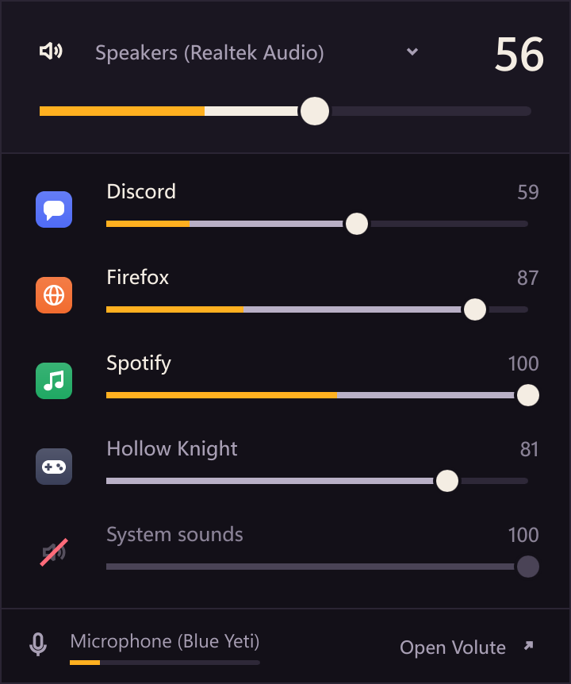
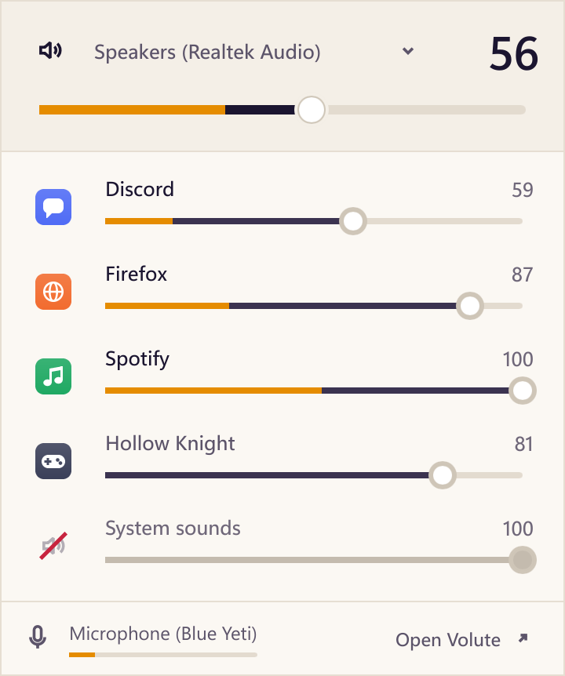
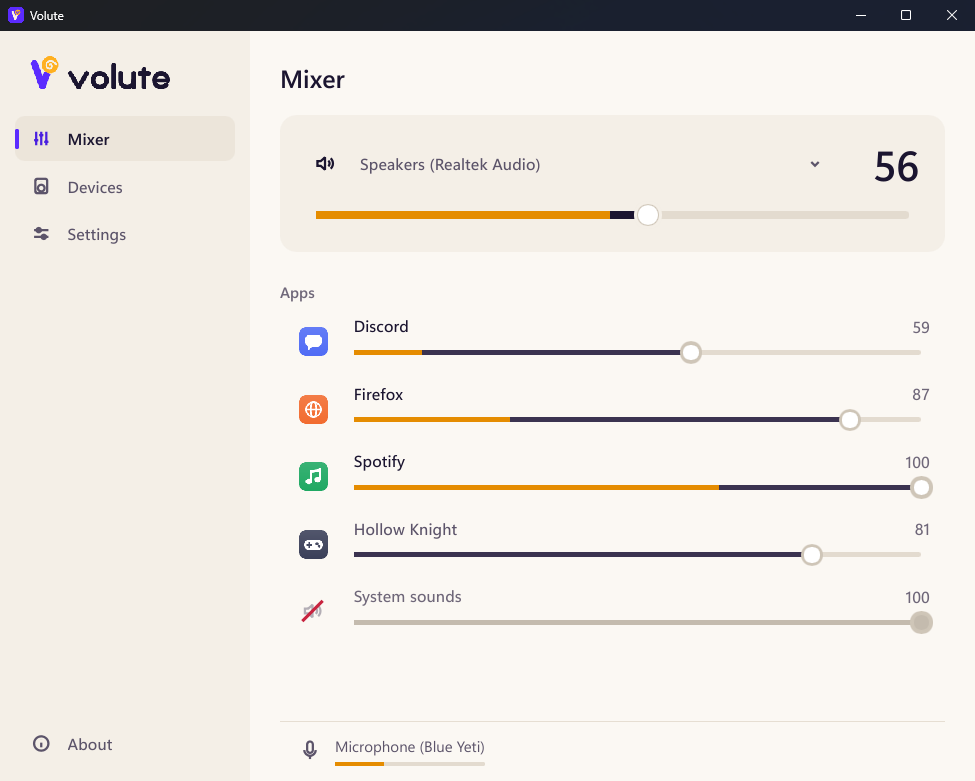

<p align="center">
  <picture>
    <source media="(prefers-color-scheme: dark)" srcset="assets/brand/png/volute-horizontal-reversed.png">
    
  </picture>
</p>

<p align="center"><strong>Every app's volume, every device, one click from the clock.</strong><br>
A volume mixer for Windows 10 and 11. Native, light, free and open source.</p>

<p align="center">
  <a href="https://github.com/EvanPluchart/volute/releases/latest"></a>
  <a href="https://github.com/EvanPluchart/volute/releases"></a>
  
  <a href="LICENSE"></a>
</p>

<p align="center">
  <a href="https://github.com/EvanPluchart/volute/releases/latest"><strong>Download</strong></a> ·
  <a href="https://evanpluchart.github.io/volute/en/">Website</a> ·
  <a href="https://evanpluchart.github.io/volute/">Site en français</a> ·
  <a href="docs/ARCHITECTURE.md">How it works</a>
</p>

<p align="center">
  
</p>

**Contents:** [Features](#features) · [Install](#install) · [Light by design](#light-by-design) · [What it reads](#what-it-reads-and-what-it-never-does) · [Coming next](#coming-next) · [Build from source](#build-from-source)

---

Changing one app's volume on Windows means a trip through Settings. Volute puts every app and every device next to the clock, with what each one is playing right now, so the whole sound of your computer is one click away.

## Features

**The mixer, next to the clock**

* **One line per app**, with its real name and icon, its volume, and what it is playing right now, glowing in amber inside the fader.
* **Mute in one click** on an app's icon. System sounds have their own line.
* **Switch the output** (speakers, headset…) from the top of the mixer.
* **Remembers** the volume you give an app, and gives it back the next time it plays.

**The speaker by the clock**

* Its waves follow the volume, and it shows when sound is muted.
* **Click it** for the mixer, **scroll over it** to change the volume.

**The main window**

* **Every device**: speakers, headsets and microphones, with their volume and level.
* **Settings**: theme, start with Windows, keep running in the notification area, updates.

**And also**

* **Updates itself** in one click, after checking that the update is signed with Volute's key.
* **Dark and light**, in English and French.

<table>
  <tr>
    <td width="40%" valign="top"></td>
    <td width="60%" valign="top"></td>
  </tr>
  <tr>
    <td align="center"><sub>The mixer, light theme</sub></td>
    <td align="center"><sub>The main window</sub></td>
  </tr>
</table>

## Install

Download the latest version from the [releases page](https://github.com/EvanPluchart/volute/releases/latest):

* **`Volute-x.y.z-setup.exe`** installs Volute for your account, without administrator rights, and can start it with Windows.
* **`Volute-x.y.z-portable.zip`** is a single executable to run from anywhere.

Then Volute keeps itself up to date: it checks for a new version when it starts and every 6 hours, and installs it in one click. Turn that off in Settings › Updates.

<details>
<summary><strong>Windows warns that the file is unknown</strong></summary>
<br>

The executables are not code-signed yet, so SmartScreen may warn on first launch: choose **More info**, then **Run anyway**. Each release publishes `SHA256SUMS`, so you can check that what you downloaded is what was built:

```powershell
Get-FileHash .\Volute-0.1.0-setup.exe -Algorithm SHA256
```

</details>

<details>
<summary><strong>How updates are checked</strong></summary>
<br>

Each release carries `SHA256SUMS` and its signature, `SHA256SUMS.sig`, made with a release key whose public half is built into Volute. Before installing anything, Volute checks that signature, then that the installer matches its checksum. A missing or wrong signature refuses the update. Only a newer version is ever installed, and a Volute running as administrator never runs a downloaded file. Details in [decision 0010](docs/decisions/0010-release-signing.md).

</details>

<details>
<summary><strong>Closing the window</strong></summary>
<br>

Closing the main window leaves Volute in the notification area, next to the clock; quit from its icon's menu. Settings › **Keep running when the window closes** turns that off.

</details>

## Light by design

Volute stays open all day, so it must cost nothing while it waits:

| | Measured |
|---|---|
| In the background | 0 % CPU, about 4 MB of memory |
| Mixer open, levels moving | about 3 % of one core |
| Installer | 6 MB |

Levels are read only while you can see them, and Volute reacts to Windows' audio events instead of asking over and over. It is written in Rust with [Slint](https://slint.dev): no browser engine, no runtime to install.

## What it reads, and what it never does

* **It reads** the audio sessions and devices Windows reports, the apps' names and icons from their executable files, and the mouse wheel only while the pointer is over its icon.
* **It changes a volume only when you ask.**
* **It never records the microphone.** Its level shows only while another app is using it, so Windows' "microphone in use" indicator keeps meaning something ([why](docs/decisions/0008-microphone-level.md)).
* **One network request**: asking GitHub whether a new version is out, and downloading it when you accept. No account, no telemetry.
* **No administrator rights.** Settings live in `%APPDATA%\Volute`.

To report a security problem, see [SECURITY.md](SECURITY.md).

## Coming next

| | |
|---|---|
| **Volume keys and an on-screen display** | Volute's own display when you press the volume keys, with the device, the volume and the app you are changing, instead of Windows' grey bar. |
| **Shortcuts** | Open the mixer, mute the microphone, cycle the output, from anywhere. |
| **Profiles** | Save a whole setup (volumes, mutes, outputs) and switch to it in one click. |
| **Per-app output** | Send one app to the headset and the rest to the speakers. |

The full plan is in the [roadmap](docs/ROADMAP.md).

## Build from source

Rust 1.88 or later, on Windows; [Inno Setup 6](https://jrsoftware.org/isinfo.php) only to build the installer.

```sh
cargo run -p volute -- --open          # the app, with its window open
cargo run -p volute -- --mock --open   # on a demo instead of your real devices
cargo xtask check                      # build, tests and lints
cargo xtask bench-overhead             # Volute's own CPU and memory
cargo xtask dist                       # installer and portable zip in dist/
```

How it is built is in [docs/ARCHITECTURE.md](docs/ARCHITECTURE.md); settled design choices are in [docs/decisions](docs/decisions), and the art direction in [docs/BRAND.md](docs/BRAND.md).

## License

[MIT](LICENSE). The interface is built with [Slint](https://slint.dev) under its [royalty-free license](https://slint.dev/terms-and-conditions#royalty-free); the attribution is in Volute's About page.
